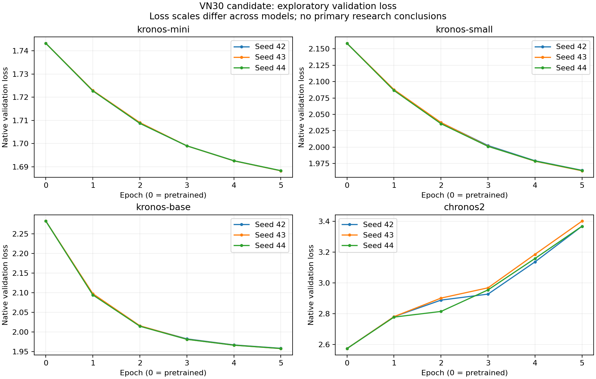

# VN30 — huấn luyện thăm dò trên PC

**Dataset chưa được chấp nhận. Không dùng bảng này để chốt Q1–Q4.**

Đồng hồ và hạn dừng dùng chung lượt PC gốc; không cấp thêm 24 giờ.

| Job | Trạng thái | Epoch tốt nhất | Validation loss | Giây train |
|---|---|---:|---:|---:|
| benchmark-kronos-mini-s42 | complete | 1 | 1.722765934430179 | 4.187000000005355 |
| benchmark-kronos-small-s42 | complete | 1 | 2.0872393694250753 | 7.98399999999674 |
| benchmark-kronos-base-s42 | complete | 1 | 2.095660343348423 | 18.453000000008615 |
| benchmark-chronos2-s42 | complete | 1 | 2.7805483705158176 | 12.23399999999674 |
| train-kronos-mini-s42 | complete | 5 | 1.6882927662858338 | 23.406000000002678 |
| train-kronos-small-s42 | complete | 5 | 1.9645944733485998 | 41.26600000000326 |
| train-kronos-base-s42 | complete | 5 | 1.9583153071061845 | 95.0 |
| train-chronos2-s42 | complete | 1 | 2.7805483705158176 | 59.578000000008615 |
| train-kronos-mini-s43 | complete | 5 | 1.6882824288721767 | 19.281000000002678 |
| train-kronos-small-s43 | complete | 5 | 1.9638827849771374 | 34.84399999999732 |
| train-kronos-base-s43 | complete | 5 | 1.9576504163652937 | 82.79699999999139 |
| train-chronos2-s43 | complete | 1 | 2.780529711476739 | 44.09399999999732 |
| train-kronos-mini-s44 | complete | 5 | 1.6883479412471023 | 18.905999999988126 |
| train-kronos-small-s44 | complete | 5 | 1.9643452130374135 | 34.65700000000652 |
| train-kronos-base-s44 | complete | 5 | 1.95778170033036 | 84.38999999999942 |
| train-chronos2-s44 | complete | 1 | 2.7775801349651776 | 40.937999999994645 |

Native loss chỉ dùng chọn epoch trong cùng model, không xếp hạng giữa model/tokenizer/objective. Đã kiểm đủ 12 lượt SFT × 5 epoch; chưa chấm MAE/RMSE test.

