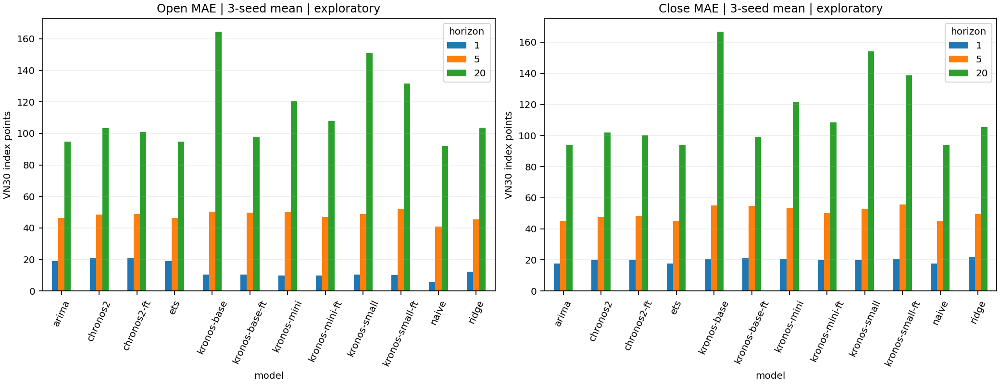
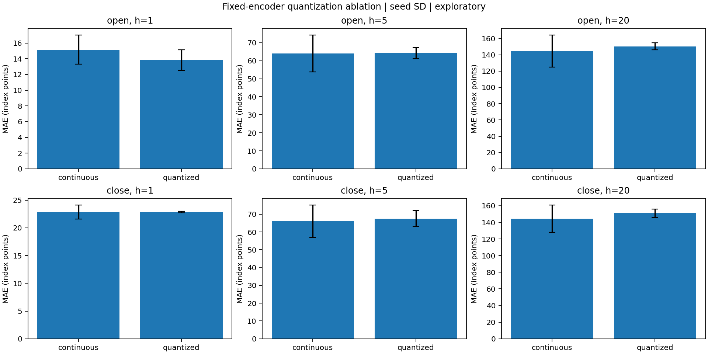
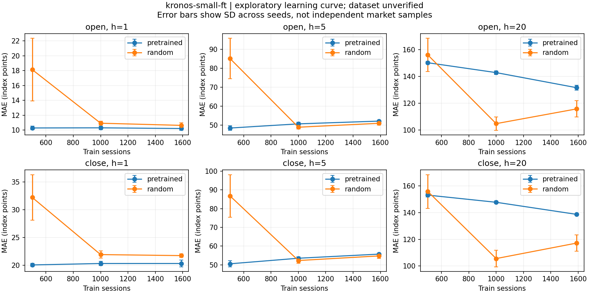
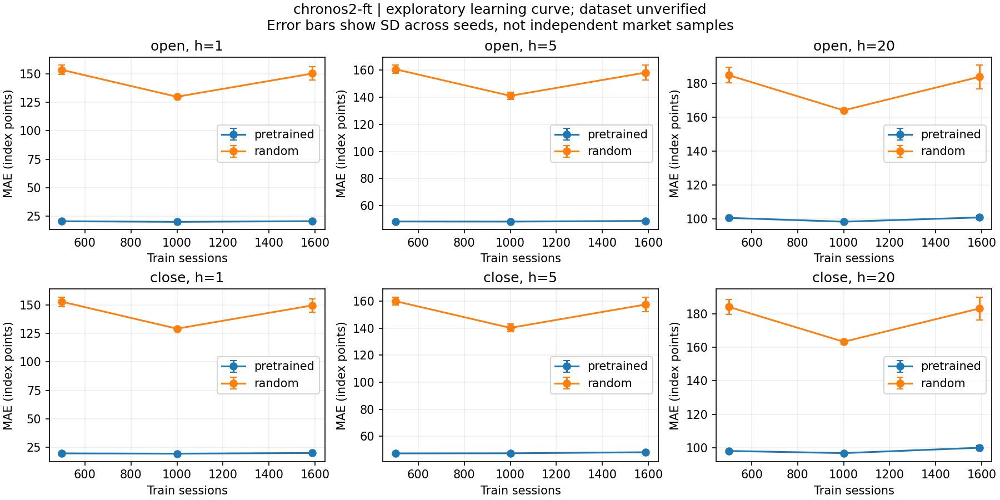

# Nghiên cứu dự báo VN30 trên PC: Kronos mini, small, base và Chronos-2-small

**Ngày tổng hợp:** 30/10/2026. **Trạng thái: báo cáo kết quả thăm dò; nghiên cứu chính chưa hoàn tất vì dữ liệu chưa được chấp nhận.**

## Tóm tắt

Nghiên cứu đánh giá dự báo mức giá Open/Close VN30 với context 128 phiên, path 20 phiên và horizon 1/5/20. Ba Kronos và Chronos-2-small được chạy zero-shot/SFT bằng ba seed, đối chiếu Naive, Ridge, ARIMA và ETS. Bổ sung learning curve pretrained/random, ablation lượng tử hóa và hai expanding folds. Tất cả kết quả dưới đây đến từ lượt PC; không lấy checkpoint hoặc score cũ để lấp.

Trong bảng chính, Naive có MAE Close thấp hơn các neural model ở cả ba horizon khi lấy trung bình ba seed. SFT Kronos-base giảm MAE Close h=20 khoảng **67.932 điểm** so với zero-shot nhưng vẫn chưa vượt Naive. Không suy từ đây rằng mọi foundation model đều kém baseline trong mọi điều kiện. Native validation của Chronos chọn epoch 0 ở cả ba seed; điểm best-trained SFT được giữ riêng để đo tác động cập nhật.

## 1. Dữ liệu và mức độ tin cậy

Snapshot VNDIRECT gồm 2.271 phiên từ 24/08/2017 đến 01/10/2026; đơn vị điểm chỉ số, ngày theo múi giờ Việt Nam. SHA256: `fee0bd8c240a9d2be4ef5c9d287eede6c5506b0358c25545e72de99709da4fd2`. Không có chỉnh sửa giá, nội suy ngày hay ghép nguồn theo ô.

Raw replay, timestamp, SQLite integrity và flags đã đạt kiểm tra. Tuy nhiên có 1.230 phép so sánh OHLC lệch hơn 0,02 điểm với VPS/DNSE, gồm 60 ngày Close khác nguồn. Đây là các sai khác cần phân xử, không phải 1.230 lỗi VNDIRECT đã chứng minh. Có 78 Open bằng Close trước, trong đó 71 phiên liên tiếp 05/05–11/08/2025; một hàng ngoài request, giữ nguyên và có chẩn đoán riêng. Request từ năm 2012 nhưng nguồn chỉ trả lịch sử từ 2017; không xem giai đoạn trước đó là đã được thu thập.

Lịch quan sát VNINDEX từ VPS khớp các ngày snapshot; nguồn DNSE thiếu 33 ngày. Điều này hỗ trợ lịch trong phạm vi nguồn, chưa phải lịch sàn chính thức. Ngưỡng 0,02 chỉ dùng phát hiện sai khác. Bản tin độc lập hỗ trợ một số giá gốc và một số giá khác; không dùng đa số phiếu để chọn nguồn. Sổ bằng chứng [data_adjudication.csv](../artifacts/local/pc-exploratory-20261030/final-report/data_adjudication.csv) giữ mọi sai khác, URL/hash và trạng thái; không nâng trạng thái audit đang khóa. Hàng ngoài request là 01/10/2026; giữ nguyên để đối chiếu snapshot, không gọi là nằm trong request.

Trong test h=1 có 59 origin mà ngày đích nằm trong đoạn Open bất thường. Naive có Open MAE bằng 0.000 trên các nhãn này, so với 7.291 trên 264 origin còn lại. Đây là chẩn đoán theo đoạn đã phát hiện, không phải tập test mới để chọn model; nó giải thích vì sao không được coi Open MAE thấp là bằng chứng dự báo giá mở cửa chính thức tốt.

Kiểm tra giả thuyết nến bao gồm mốc Close trước: công thức `High=max(High nguồn đối chiếu, Close trước)` và `Low=min(Low nguồn đối chiếu, Close trước)` chỉ khớp 24/575 sai khác High/Low trong ngưỡng 0,02. Vì vậy đây không phải lời giải chung cho khác biệt nhà cung cấp và không đủ căn cứ sửa giá. [Chẩn đoán theo nguồn/trường](../artifacts/local/pc-exploratory-20261030/final-report/previous_close_anchor_diagnostic.csv) giữ kết quả kiểm tra giả thuyết, tách khỏi quyết định phân xử.

Vì chưa giải thích đủ O/H/L/Close, kết quả chỉ mô tả hành vi trên nhãn của snapshot, đặc biệt Open/gap còn thăm dò. Ngày bắt đầu chuỗi Open bất thường trùng KRX vận hành là giả thuyết, chưa chứng minh nguyên nhân. [Hồ sơ điều tra](../artifacts/local/pc-preflight-20261030/evidence_review.md) lưu nguồn và giới hạn.

## 2. Thiết kế và khả năng tái lập

| split | first | last | sessions | origins |
| --- | --- | --- | --- | --- |
| train | 2017-08-24 | 2023-12-29 | 1589 | 1442 |
| validation | 2024-01-02 | 2025-05-20 | 340 | 321 |
| test | 2025-05-21 | 2026-10-01 | 342 | 323 |

Mỗi origin đặt sau Close phiên t; toàn bộ 20 nhãn nằm trong split tương ứng. Context được phép dùng quá khứ trước ranh giới. Dự báo được lưu trước khi ghép nhãn. Test lịch sử đã được xem trong nghiên cứu trước, nên đây là đánh giá hồi cứu. Không tuyên bố checkpoint pretrained chưa từng thấy VN30; cutoff của mọi revision chưa được xác minh đầy đủ. Các fold lịch sử cũng không phải backtest triển khai sạch.

Kronos-mini dùng Tokenizer-2k; small/base dùng Tokenizer-base. Predictor SFT cập nhật toàn bộ trọng số, tokenizer cố định. FP32, AdamW, tối đa năm epoch, LR 1e-6, effective batch 16, gradient clipping 1, weight decay 0,01. Seed 42/43/44. Kronos lấy trung bình ba path, temperature 1, top-p 0,9; Chronos lấy trung bình đều 13 quantile, không phải 13 mẫu ngẫu nhiên. Volume/amount thiếu được điền 0 theo adapter; đó không phải khối lượng thực. Kronos nhận ngày phiên đích lịch sử đã biết, là giới hạn của đánh giá hồi cứu.

MAE là metric chính; RMSE bổ sung. Điểm Open/Close có đơn vị điểm chỉ số. Seed SD mô tả biến thiên chạy, không thay thế khoảng tin cậy theo thị trường. Nhãn `-ft` luôn chỉ **best-trained**; bảng selected riêng tuân theo validation có xét epoch 0. Bảng MAE/RMSE validation/test đầy đủ nằm ở [main_summary.csv](../artifacts/local/pc-exploratory-20261030/final-report/main_summary.csv).

## 3. Q1 — Neural model và baseline thống kê

Naive đặt Open/Close ở mọi horizon bằng Close tại origin. Ridge học ánh xạ từ context OHLC sang path tương lai, scaler/hệ số chỉ fit trên train. Các cấu hình baseline chọn bằng validation, tiêu chí trung bình MAE Open/Close tại ba horizon chuẩn hóa bằng độ lệch chuẩn train. ARIMA/ETS refit từng origin trên 128 phiên quá khứ từng kênh; không có seasonal. Ứng viên không phủ đủ mẫu hoặc hội tụ lỗi không được dùng để thắng lựa chọn; không Naive fallback.

| model | grid_candidates | eligible_candidates | failed_origin_fits | selected_config | validation_loss |
| --- | --- | --- | --- | --- | --- |
| ridge | 4 | 4 | 0 | {"alpha": 10.0} | 0.122 |
| arima | 18 | 12 | 491 | {"order": [0, 1, 0]} | 0.103 |
| ets | 3 | 3 | 0 | {"trend": null, "damped_trend": false} | 0.104 |

### Test: MAE Close, trung bình ± SD ba seed

| model | h=1 | h=5 | h=20 |
| --- | --- | --- | --- |
| arima | 17.722 ± 0.000 | 45.165 ± 0.000 | 93.826 ± 0.000 |
| chronos2 | 19.995 ± 0.000 | 47.699 ± 0.000 | 102.072 ± 0.000 |
| chronos2-ft | 20.104 ± 0.421 | 48.198 ± 0.428 | 99.976 ± 1.244 |
| ets | 17.722 ± 0.000 | 45.165 ± 0.000 | 93.826 ± 0.000 |
| kronos-base | 20.889 ± 0.132 | 55.148 ± 0.574 | 166.781 ± 0.712 |
| kronos-base-ft | 21.234 ± 0.417 | 54.709 ± 0.562 | 98.849 ± 1.525 |
| kronos-mini | 20.587 ± 0.382 | 53.345 ± 0.859 | 121.571 ± 0.845 |
| kronos-mini-ft | 20.127 ± 0.920 | 50.188 ± 0.219 | 108.490 ± 1.706 |
| kronos-small | 19.906 ± 0.566 | 52.586 ± 0.327 | 154.143 ± 1.136 |
| kronos-small-ft | 20.326 ± 0.594 | 55.690 ± 0.285 | 138.716 ± 0.279 |
| naive | 17.722 ± 0.000 | 45.165 ± 0.000 | 93.826 ± 0.000 |
| ridge | 21.597 ± 0.000 | 49.598 ± 0.000 | 105.211 ± 0.000 |

### Test: MAE Open, trung bình ± SD ba seed

| model | h=1 | h=5 | h=20 |
| --- | --- | --- | --- |
| arima | 18.999 ± 0.000 | 46.270 ± 0.000 | 94.720 ± 0.000 |
| chronos2 | 21.045 ± 0.000 | 48.651 ± 0.000 | 103.229 ± 0.000 |
| chronos2-ft | 20.671 ± 0.555 | 48.740 ± 0.518 | 100.810 ± 1.251 |
| ets | 19.017 ± 0.000 | 46.288 ± 0.000 | 94.700 ± 0.000 |
| kronos-base | 10.408 ± 0.178 | 50.477 ± 0.377 | 164.544 ± 0.439 |
| kronos-base-ft | 10.466 ± 0.313 | 49.770 ± 0.714 | 97.545 ± 1.373 |
| kronos-mini | 9.726 ± 0.111 | 49.886 ± 1.208 | 120.706 ± 0.866 |
| kronos-mini-ft | 9.806 ± 0.100 | 46.878 ± 0.527 | 107.852 ± 1.582 |
| kronos-small | 10.428 ± 0.206 | 48.808 ± 0.618 | 151.298 ± 1.071 |
| kronos-small-ft | 10.208 ± 0.262 | 52.177 ± 0.445 | 131.519 ± 1.763 |
| naive | 5.959 ± 0.000 | 40.846 ± 0.000 | 91.951 ± 0.000 |
| ridge | 12.392 ± 0.000 | 45.368 ± 0.000 | 103.683 ± 0.000 |

Baseline deterministic dùng chung forecast giữa các seed; ba dòng tương ứng không phải ba lần ước lượng độc lập. ARIMA(0,1,0) và ETS level trong cấu hình thắng cho Close trùng Naive; không diễn giải ba nhãn này thành ba bằng chứng độc lập về ưu thế.



**Trả lời Q1:** chưa có lợi thế tổng thể của neural model trước Naive trên Close trong thiết lập đã thử. Kết luận chỉ áp dụng snapshot, protocol và các checkpoint này; các kết quả Open chịu giới hạn dữ liệu nêu trên.

## 4. SFT và lựa chọn có tính epoch 0

| model | seed | best_trained_epoch | selected_epoch | initial_validation_loss | best_trained_validation_loss | selected_validation_loss |
| --- | --- | --- | --- | --- | --- | --- |
| kronos-mini | 42 | 5 | 5 | 1.743 | 1.688 | 1.688 |
| kronos-mini | 43 | 5 | 5 | 1.743 | 1.688 | 1.688 |
| kronos-mini | 44 | 5 | 5 | 1.743 | 1.688 | 1.688 |
| kronos-small | 42 | 5 | 5 | 2.158 | 1.965 | 1.965 |
| kronos-small | 43 | 5 | 5 | 2.158 | 1.964 | 1.964 |
| kronos-small | 44 | 5 | 5 | 2.158 | 1.964 | 1.964 |
| kronos-base | 42 | 5 | 5 | 2.283 | 1.958 | 1.958 |
| kronos-base | 43 | 5 | 5 | 2.283 | 1.958 | 1.958 |
| kronos-base | 44 | 5 | 5 | 2.283 | 1.958 | 1.958 |
| chronos2 | 42 | 1 | 0 | 2.573 | 2.781 | 2.573 |
| chronos2 | 43 | 1 | 0 | 2.573 | 2.781 | 2.573 |
| chronos2 | 44 | 1 | 0 | 2.573 | 2.778 | 2.573 |

Chronos có native validation pretrained tốt hơn mọi epoch cập nhật ở cả ba seed. Vì vậy lựa chọn có xét epoch 0 là pretrained; không được gọi SFT là cải thiện validation. Kronos chọn epoch 5 trong ngân sách năm epoch, không khẳng định đã hội tụ. Token cross-entropy và quantile loss không so trực tiếp giữa họ model/tokenizer. [Selected scores](../artifacts/local/pc-exploratory-20261030/final-report/selected_scores.csv) lấy đúng forecast của checkpoint đã được validation chọn, không chọn theo test.

## 5. Q2 — Kích thước và representation

Bảng chính cho phép so sánh các hệ thống mini/small/base. Mini khác tokenizer nên khác biệt không phải ảnh hưởng thuần túy của số tham số. Đối chứng representation dùng cùng encoder tokenizer small cố định; đặc trưng liên tục L2-normalized so với đặc trưng BSQ; cùng backbone random small, numeric head/MSE, dữ liệu và ngân sách. Ba seed đều có hash backbone khởi tạo khớp giữa hai nhánh.

### Ablation: Close test, mean và SD giữa seed

| model | horizon | seeds | mae | mae_sd | rmse |
| --- | --- | --- | --- | --- | --- |
| naive | 1 | 3 | 17.722 | 0.000 | 24.523 |
| naive | 5 | 3 | 45.165 | 0.000 | 55.736 |
| naive | 20 | 3 | 93.826 | 0.000 | 115.258 |
| representation-continuous | 1 | 3 | 22.832 | 1.255 | 31.057 |
| representation-continuous | 5 | 3 | 66.015 | 9.060 | 84.165 |
| representation-continuous | 20 | 3 | 144.375 | 16.360 | 184.167 |
| representation-quantized | 1 | 3 | 22.832 | 0.134 | 30.202 |
| representation-quantized | 5 | 3 | 67.571 | 4.365 | 87.400 |
| representation-quantized | 20 | 3 | 150.927 | 5.131 | 199.498 |



Bảng đầy đủ [ablation_summary.csv](../artifacts/local/pc-exploratory-20261030/final-report/ablation_summary.csv) chứa cả Open/Close và validation. Đây là phép can thiệp lượng tử hóa trong thiết lập cố định, không tách mọi thành phần của K-line representation. Không dùng Kronos–Chronos hoặc bỏ kênh giá để suy quan hệ nhân quả cho toàn bộ representation. Kết luận về chiều tác động phải đọc theo từng horizon/target trong bảng, không khẳng định lợi ích đồng nhất.

**Trả lời Q2:** với Close, hai nhánh gần như ngang nhau tại h=1 (continuous 22.832, quantized 22.832 điểm); lượng tử hóa có MAE trung bình cao hơn ở h=5 (67.571 so với 66.015) và h=20 (150.927 so với 144.375). Chưa có bằng chứng lượng tử hóa cải thiện đồng nhất trong ablation này. SD giữa ba seed lớn ở một số ô; không coi chênh lệch mean nhỏ là ý nghĩa thống kê. Ở bảng SFT, mini có Close MAE thấp hơn small tại cả ba horizon, nên tăng kích thước cũng không cho lợi thế đơn điệu; khác tokenizer vẫn ngăn diễn giải thành hiệu ứng số tham số thuần túy.

## 6. Q3 — Lượng dữ liệu và predictor pretraining

Train 500/1.000/toàn bộ 1.589 phiên lồng nhau cùng ngày kết thúc, tương ứng 353/853/1.442 cửa sổ. Giữ nguyên validation/test. Hai model đại diện: Kronos-small và Chronos-2-small; mỗi cấu hình ba seed, pretrained hoặc predictor random. Random chọn LR trong 1e-6/1e-5/1e-4 bằng native validation; lưu trial thắng và dùng trực tiếp checkpoint đó để tránh train trùng. Sáu full-budget pretrained checkpoint được tái dùng từ lượt PC sau kiểm protocol, không lấy từ môi trường cũ.

### Learning curve Close test

| model | initialization | train_rows | train_windows | h=1 | h=5 | h=20 |
| --- | --- | --- | --- | --- | --- | --- |
| chronos2-ft | pretrained | 500 | 353 | 19.753 | 47.364 | 98.074 |
| chronos2-ft | pretrained | 1000 | 853 | 19.498 | 47.449 | 96.782 |
| chronos2-ft | pretrained | 1589 | 1442 | 20.104 | 48.198 | 99.976 |
| chronos2-ft | random | 500 | 353 | 152.647 | 160.078 | 184.120 |
| chronos2-ft | random | 1000 | 853 | 129.054 | 140.272 | 163.259 |
| chronos2-ft | random | 1589 | 1442 | 149.456 | 157.607 | 183.093 |
| kronos-small-ft | pretrained | 500 | 353 | 20.067 | 50.523 | 153.161 |
| kronos-small-ft | pretrained | 1000 | 853 | 20.325 | 53.489 | 147.780 |
| kronos-small-ft | pretrained | 1589 | 1442 | 20.326 | 55.690 | 138.716 |
| kronos-small-ft | random | 500 | 353 | 32.188 | 86.797 | 155.908 |
| kronos-small-ft | random | 1000 | 853 | 21.925 | 52.265 | 105.597 |
| kronos-small-ft | random | 1589 | 1442 | 21.743 | 54.729 | 117.220 |





Bảng [learning_curve.csv](../artifacts/local/pc-exploratory-20261030/final-report/learning_curve.csv) chứa cả target, split, mean/SD và số cửa sổ. [random_lr_selection.csv](../artifacts/local/pc-exploratory-20261030/final-report/random_lr_selection.csv) ghi lựa chọn validation. Sai số thay đổi theo budget không được mặc định đơn điệu. Lợi ích predictor pretraining chỉ được kết luận trong ngân sách huấn luyện đã thử; random Kronos vẫn dùng tokenizer pretrained. Không đồng nhất năm epoch với tối ưu đến hội tụ hoặc random predictor với toàn hệ thống chưa pretrain.

**Trả lời Q3:** pretrained Chronos có Close MAE thấp hơn random trong cả chín ô budget/horizon; random còn kém xa trong ngân sách này. Kronos-small không cho lợi ích phổ quát: tại 1.000 phiên, random tốt hơn pretrained ở h=5/20 (52.265/105.597 so với 53.489/147.780); full budget cũng có lợi thế random tại h=5/20. Với pretrained Kronos-small, thêm dữ liệu giúp h=20 nhưng không cải thiện h=1/5. Không dùng kết quả test này để đổi LR/epoch hoặc chọn budget triển khai. Random được thử ba LR trong khi pretrained giữ LR chính, nên tổng chi phí tìm cấu hình không bằng nhau dù mỗi trial đều tối đa năm epoch.

## 7. Q4 — Seed, thời gian, volatility và folds

Volatility là SD của 20 log-return đã biết tại origin (ddof=1); ngưỡng p90 chỉ fit trên train. Test chính có **17/323 origin volatility cao**, tạo **2 cụm liên tiếp**. Cụm này không được mặc định là các biến cố độc lập. Ba đoạn test liên tiếp được chia theo origin; số mẫu và ranh giới có trong [origin_regimes.csv](../artifacts/local/pc-exploratory-20261030/final-report/origin_regimes.csv). Không dùng `volatility_diagnostic.csv` mô tả theo return thực hiện tương lai làm regime của Q4.

Paired moving-block bootstrap so chênh lệch absolute error cùng origin với Naive: block 20 origin, 2.000 draws, percentile 95%, RNG seed 42. Đã tính lại độc lập từ forecast và SQLite; không bootstrap seed như các thị trường độc lập. CI chưa điều chỉnh multiple comparisons và phụ thuộc giả định block; không diễn giải thành bảo đảm lợi nhuận.

### CI Close của seed 42, bảng chính

| model | horizon | n | difference | ci_low | ci_high |
| --- | --- | --- | --- | --- | --- |
| kronos-mini-ft | 1 | 323 | 1.657 | 0.369 | 2.820 |
| kronos-mini-ft | 5 | 323 | 4.779 | 1.732 | 8.373 |
| kronos-mini-ft | 20 | 323 | 12.738 | -0.257 | 27.575 |
| kronos-small-ft | 1 | 323 | 1.923 | -0.435 | 4.147 |
| kronos-small-ft | 5 | 323 | 10.443 | 1.700 | 22.576 |
| kronos-small-ft | 20 | 323 | 44.896 | 13.737 | 85.757 |
| kronos-base-ft | 1 | 323 | 3.031 | 0.899 | 5.149 |
| kronos-base-ft | 5 | 323 | 9.236 | 1.284 | 17.878 |
| kronos-base-ft | 20 | 323 | 3.488 | -18.439 | 26.387 |
| chronos2-ft | 1 | 323 | 1.935 | 0.734 | 3.010 |
| chronos2-ft | 5 | 323 | 2.772 | -0.539 | 5.990 |
| chronos2-ft | 20 | 323 | 5.666 | -4.396 | 15.555 |

Chênh lệch âm nghĩa là MAE thấp hơn Naive. CI từng seed và fold/ablation đầy đủ ở [paired_intervals.csv](../artifacts/local/pc-exploratory-20261030/final-report/paired_intervals.csv); bảng regime/period ở [regime_period_scores.csv](../artifacts/local/pc-exploratory-20261030/final-report/regime_period_scores.csv). Không lấy trung bình hai đầu CI qua các seed để tạo một CI tổng hợp.

### Close h=20 theo regime/giai đoạn, trung bình ba seed

| model | grouping | label | n | mae | mae_sd |
| --- | --- | --- | --- | --- | --- |
| chronos2-ft | period | period-1 | 108 | 103.874 | 3.966 |
| chronos2-ft | period | period-2 | 108 | 111.084 | 2.084 |
| chronos2-ft | period | period-3 | 107 | 84.830 | 1.094 |
| chronos2-ft | regime | high | 17 | 188.250 | 2.730 |
| chronos2-ft | regime | normal | 306 | 95.072 | 1.180 |
| kronos-base-ft | period | period-1 | 108 | 108.828 | 3.146 |
| kronos-base-ft | period | period-2 | 108 | 102.620 | 1.818 |
| kronos-base-ft | period | period-3 | 107 | 84.971 | 2.521 |
| kronos-base-ft | regime | high | 17 | 112.710 | 6.336 |
| kronos-base-ft | regime | normal | 306 | 98.079 | 1.872 |
| kronos-mini-ft | period | period-1 | 108 | 153.116 | 3.058 |
| kronos-mini-ft | period | period-2 | 108 | 92.096 | 0.980 |
| kronos-mini-ft | period | period-3 | 107 | 79.993 | 1.135 |
| kronos-mini-ft | regime | high | 17 | 141.836 | 2.274 |
| kronos-mini-ft | regime | normal | 306 | 106.637 | 1.927 |
| kronos-small-ft | period | period-1 | 108 | 236.885 | 0.531 |
| kronos-small-ft | period | period-2 | 108 | 96.716 | 0.385 |
| kronos-small-ft | period | period-3 | 107 | 82.023 | 1.047 |
| kronos-small-ft | regime | high | 17 | 127.385 | 2.977 |
| kronos-small-ft | regime | normal | 306 | 139.346 | 0.216 |
| naive | period | period-1 | 108 | 109.977 | 0.000 |
| naive | period | period-2 | 108 | 98.685 | 0.000 |
| naive | period | period-3 | 107 | 72.618 | 0.000 |
| naive | regime | high | 17 | 159.355 | 0.000 |
| naive | regime | normal | 306 | 90.185 | 0.000 |

Nhóm volatility được xác định tại origin, không phải từ giá tương lai tại ngày đích. Bảng trung bình/SD đầy đủ cho cả Open/Close và ba horizon ở [regime_period_summary.csv](../artifacts/local/pc-exploratory-20261030/final-report/regime_period_summary.csv); subgroup ít mẫu không được coi là xác nhận lợi thế qua nhiều biến cố độc lập.

### Hai expanding folds, neural seed 42

| fold | train_end | validation_start | validation_end | test_start | test_end | test_origins |
| --- | --- | --- | --- | --- | --- | --- |
| fold1 | 2022-03-11 | 2022-03-14 | 2023-02-08 | 2023-02-09 | 2023-12-29 | 208 |
| fold2 | 2023-02-08 | 2023-02-09 | 2023-12-29 | 2024-01-02 | 2024-11-28 | 208 |

Mỗi fold huấn luyện và chọn checkpoint trên train/validation riêng trước test của fold. Chấm đủ bốn neural model zero-shot/best-trained và Naive; [fold_scores.csv](../artifacts/local/pc-exploratory-20261030/final-report/fold_scores.csv) lưu metric validation/test. Fold hồi cứu có thể nằm trước thời điểm checkpoint công khai; không coi việc chia thời gian là bằng chứng loại bỏ rò rỉ pretraining.

### MAE Close của hai fold

| fold | model | h=1 | h=5 | h=20 |
| --- | --- | --- | --- | --- |
| fold1 | chronos2 | 10.829 | 24.046 | 44.165 |
| fold1 | chronos2-ft | 10.417 | 22.213 | 40.958 |
| fold1 | kronos-base | 10.683 | 26.395 | 66.885 |
| fold1 | kronos-base-ft | 11.524 | 25.392 | 56.358 |
| fold1 | kronos-mini | 10.541 | 25.600 | 50.098 |
| fold1 | kronos-mini-ft | 10.474 | 23.655 | 49.682 |
| fold1 | kronos-small | 11.039 | 27.526 | 57.831 |
| fold1 | kronos-small-ft | 10.990 | 27.708 | 59.611 |
| fold1 | naive | 9.472 | 22.363 | 40.009 |
| fold2 | chronos2 | 9.241 | 21.020 | 37.369 |
| fold2 | chronos2-ft | 10.449 | 21.978 | 42.643 |
| fold2 | kronos-base | 9.965 | 21.526 | 53.029 |
| fold2 | kronos-base-ft | 10.087 | 26.404 | 42.151 |
| fold2 | kronos-mini | 9.592 | 22.950 | 45.265 |
| fold2 | kronos-mini-ft | 9.779 | 22.362 | 41.484 |
| fold2 | kronos-small | 9.515 | 21.456 | 43.456 |
| fold2 | kronos-small-ft | 10.216 | 24.614 | 40.315 |
| fold2 | naive | 8.395 | 20.580 | 36.072 |

**Trả lời Q4:** chưa có lợi thế ổn định trước Naive. Chronos SFT nhỉnh hơn Naive tại fold1 h=5 (22.213 so với 22.363), nhưng không giữ lợi thế ở fold2; các neural model còn lại cũng không thắng nhất quán cả ba horizon và hai fold. Cả hai fold có **0 origin volatility cao** theo ngưỡng train riêng, nên chúng không bổ sung bằng chứng cho regime cao. Test chính chỉ có 17 origin cao trong 2 cụm; không thể suy độ bền qua nhiều khủng hoảng độc lập. Đọc CI từng seed/horizon để phân biệt chênh lệch số học với bằng chứng bất định.

## 8. Chi phí và kiểm định

RTX 4070 SUPER 12 GB, RAM khoảng 32 GB, Python 3.11.9; torch 2.14.0+cu130 đã kiểm CUDA thực tế. GPU chạy tuần tự. Bảng dưới là thời gian đo, không phải dự toán; peak allocated là bộ nhớ tensor do PyTorch ghi nhận, không phải tổng VRAM tiến trình.

| model | parameters | train_seconds_mean | peak_allocated_GiB | epoch_seconds | validation_32_origins_seconds |
| --- | --- | --- | --- | --- | --- |
| chronos2 | 27934624 | 48.203 | 0.564 | 12.234 | 7.359 |
| kronos-base | 102310592 | 87.396 | 2.543 | 18.453 | 13.656 |
| kronos-mini | 4108032 | 20.531 | 0.198 | 4.187 | 7.343 |
| kronos-small | 24741376 | 36.922 | 0.780 | 7.984 | 7.547 |

Hạn gốc 31/10/2026 14:09:17 +07; hàng đợi kết thúc 30/10/2026 18:22:28 +07. Không reset đồng hồ. 90 cặp training/selection receipts gồm benchmark, main, LR trials và folds; không phải 90 mẫu nghiên cứu độc lập. Loss/history/checkpoint vẫn giữ trên PC; code, CSV, đồ thị và receipts được lưu Git.

Kiểm định số học trực tiếp: 88 nhóm score, 182 file forecast, 2.160 dòng metric khớp nhãn SQLite; 85 output receipts và 90 cặp training/selection khớp hash. Ca đổi ngày đích bị từ chối. Kiểm định thống kê độc lập lần này xác nhận 378 CI và 1782 metric regime/period. Bộ kiểm thử sau hoàn thiện đạt 64 ca, skipped=1; native GPU opt-in đã chạy riêng trước đó. Native GPU resume mini sai khác tham số tối đa 5,96e-8; chưa kiểm stress forced-OOM và resume toàn bộ variant.

## 9. Kết luận và điều kiện chưa đạt

Các khoảng trống thí nghiệm của bài cũ đã có kết quả PC thăm dò: baseline thống kê, ba kích thước Kronos, ba seed, learning curve/random controls, ablation và folds. Tuy nhiên **nghiên cứu chính vẫn chưa đủ điều kiện chốt hoàn thiện**: nhãn OHLC chưa được phân xử đủ, Open chính thức và lịch sàn chưa xác nhận hoàn toàn, pretraining cutoff chưa đủ cho tuyên bố triển khai lịch sử sạch. Không dùng kết quả thăm dò để đóng cổng kiểm toán chính.

Ma trận nghiệm thu từng yêu cầu và bằng chứng/giới hạn: [completion_matrix.csv](../artifacts/local/pc-exploratory-20261030/final-report/completion_matrix.csv). “Verified exploratory” chỉ xác nhận thí nghiệm và phép tính trên snapshot; không đồng nghĩa giá thị trường đã được xác nhận.

Không có backtest giao dịch, transaction costs, Directional Accuracy hoặc bản theo mẫu tạp chí trong phạm vi đã chốt. Sai số chỉ số không suy ra lợi nhuận. Nếu dữ liệu được hiệu chỉnh, phải có phiên bản/manifest riêng và kiểm tra lại toàn bộ thí nghiệm phụ thuộc; không đổi nhãn checkpoint của snapshot gốc.

## 10. Tái lập và hồ sơ nguồn

Từ repo root, dùng môi trường đã khóa và chạy:

```powershell
.venv/Scripts/python.exe experiments/verify_completed_candidate.py
.venv/Scripts/python.exe experiments/finalize_pc_report.py
```

Lệnh thứ nhất kiểm byte checkpoints local nên cần giữ thư mục weights. Lệnh thứ hai kiểm receipt/input/frozen core, tính lại thống kê, sinh bảng/hình và báo cáo này; không cần train/inference GPU lại. Cần giữ các raw công bố đã tải tại PC; [source_catalog.json](../artifacts/local/pc-exploratory-20261030/final-report/source_catalog.json) ghi URL/hash để truy vết. Raw bổ sung không nằm trong Git; tải lại HTML động có thể không trùng bytes, khi đó phải dùng bản archive gốc chứ không sửa hash cho qua. Tham số `--candidate`, `--output`, `--report` cho phép chọn output; không trộn các snapshot. Xem [quy trình PC](PC_Rerun.md) cho tải dữ liệu, environment, train và inference; các stage cap/deadline vẫn áp dụng khi chạy tiếp lượt gốc.

- [Numerical validation](../artifacts/local/pc-exploratory-20261030/review/numerical_validation.json), [final verification](../artifacts/local/pc-exploratory-20261030/final-report/verification.json) và [report sources](../artifacts/local/pc-exploratory-20261030/final-report/report_sources.json).
- Model/tokenizer mapping: [Kronos chính thức](https://github.com/shiyu-coder/Kronos#-model-zoo); revision/hash cụ thể ở [checkpoint provenance](../data/manifests/checkpoint_provenance.yaml).
- Dữ liệu, request và raw replay: [audit snapshot](../artifacts/local/pc-rerun-20261030/audit/summary.md); [calendar đối chiếu](../artifacts/local/pc-preflight-20261030/calendar_crosscheck/audit/summary.md).
- Bản lịch sử được giữ riêng ở [báo cáo 27/10](VN30_Experimental_Results_Q1_Q4.md); không dùng số liệu đó trong các bảng PC.
